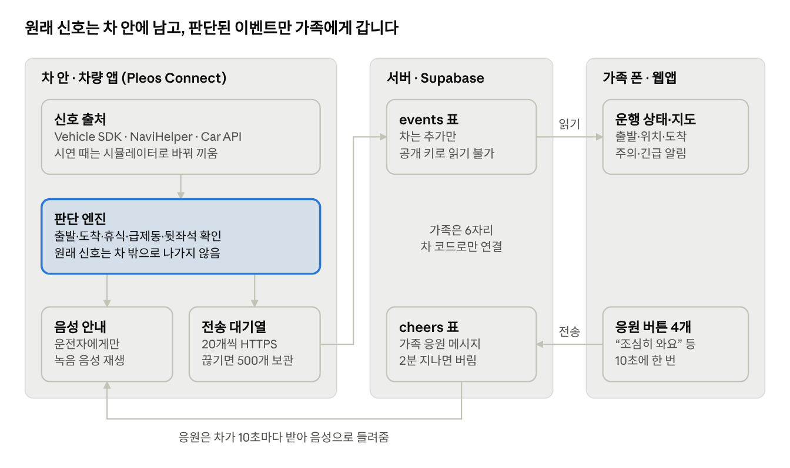

# 운전복복

**차가 이미 알고 있는 정보로, 가족이 운전해 돌아오는 길을 출발부터 도착까지 대신 알려 주는 Pleos Connect 차량 앱입니다.**

운전자는 화면을 보지 않고 음성 안내만 듣고, 기다리는 가족은 폰으로 출발·위치·도착·주의·긴급 알림을 받습니다. 가족이 응원 메시지를 보내면 차 안에서 음성으로 들려줍니다.

현대자동차그룹 차량용 앱 개발 공모전 제출작입니다(팀 에리복복).



- **APK**: [`apk/에리복복_운전복복_release.apk`](apk/) (release 빌드)
- **테스트 환경**: Pleos Connect v2.1.0 에뮬레이터 (Android 14, API 34)
- **빠르게 보기**: 앱의 **시뮬레이터 탭 → ▶ 시연 재생** (약 75초, 서버 없이 동작)

## 실행 방법

### 1. 차량 앱 설치·실행

1. Android Studio의 Device Manager에서 **Pleos Connect v2.1.0** 에뮬레이터를 켭니다.
2. APK를 설치합니다. APK 파일을 에뮬레이터 창에 끌어다 놓거나, 터미널에서 아래 명령을 실행합니다.
   ```
   adb install -r apk/에리복복_운전복복_release.apk
   ```
3. 앱 목록에서 **운전복복**을 엽니다. 처음 실행할 때 나오는 권한 요청(속도 정보, 화면에는 '위치 정보'로 표시될 수 있음)을 **허용**합니다.

### 2. 기능 확인 (서버 없이)

| 탭 | 확인할 것 |
|---|---|
| **시뮬레이터** | **▶ 시연 재생**을 누르면 약 75초 동안 아이를 태운 출발 → 휴식 안내 → 급제동 → 비(와이퍼) → 가족 응원 메시지 → 도착 → 뒷좌석 확인이 자동으로 진행됩니다. 버튼으로 문·벨트·에어백·속도 같은 신호를 직접 넣어 볼 수도 있습니다. |
| **운행** | 지금 상태(주행·정차, 연속 운전 시간, 목적지)와 가족에게 보낸 알림 흐름, 재생된 안내음을 보여 줍니다. |
| **진단** | 에뮬레이터에서 실제로 받는 차량 값을 초록(받음)·노랑(이 차에 없음)·빨강(오류)으로 보여 줍니다. |
| **설정** | 차 코드(가족 앱 연결용 6자리), 서버 주소, 아이 동승 모드, 시연용 짧은 시간 설정이 있습니다. |

에어백처럼 에뮬레이터에 없는 값은 시뮬레이터 탭으로 넣어 확인합니다. Pleos 에뮬레이터는 일반 사용자용(user) 빌드라 차량 값을 바꿔 넣을 수 없기 때문입니다.

### 3. 가족 앱 체험 (서버 없이)

가족 앱은 설치 없이 폰 브라우저로 여는 웹앱입니다. 체험 모드는 가상 데이터로 출발 → 휴식 → 급제동 → 도착 → 뒷좌석 알림이 약 1분 동안 흐르고, 응원 메시지와 긴급 화면도 눌러 볼 수 있습니다.

```
cd family-web
python3 -m http.server 8080
```

브라우저에서 `http://localhost:8080/?demo=1`을 엽니다. 폰 크기로 보려면 개발자 도구의 기기 모드를 켭니다.

### 4. 서버까지 연결하기 (선택)

차량 앱과 가족 앱을 실제로 연결하려면 Supabase 프로젝트가 필요합니다. 설정 순서는 [docs/SETUP.md](docs/SETUP.md)에 있습니다.

## 테스트 환경

| 항목 | 내용 |
|---|---|
| 차량 앱 실행 | Pleos Connect v2.1.0 에뮬레이터 (Android 14, API 34) |
| 빌드 | Android Studio, Gradle 8.10.2, Gradle JDK 21, AGP 8.8.2, Kotlin 2.0.0 |
| 차량 SDK | Pleos Vehicle SDK 2.3.2, NaviHelper 3.0.5, Android 표준 차량 API(`android.car`) |
| 앱 설정 | compileSdk 35, minSdk 28, targetSdk 35 |
| 가족 앱 | 모바일 브라우저 (폰 화면 390px, 밝은·어두운 화면에서 확인) |
| 서버 | Supabase (PostgreSQL + REST). 권한 검사는 PostgreSQL 16에서 확인 |
| 단위 테스트 | JUnit 4, 57개 |

## 기능

| 기능 | 언제 | 차 안(운전자) | 가족 폰 |
|---|---|---|---|
| 출발 전 체크 | 기어를 D로 바꿀 때 | 벨트 미착용·정비 경고·잔량 15% 이하가 있으면 안내음 한 번 | 출발 알림에 점검 결과. 벨트를 안 맨 채 30초 넘게 달리면 주의 알림 |
| 안심 귀가 | 출발·주행 중·도착 | 조작 없음 | 출발 알림, 30초마다 지도 위치, 도착 알림(주행 시간·거리·휴식 횟수) |
| 휴식 안내 | 쉬지 않고 2시간 운전(이후 30분마다) | "오래 운전하셨어요. 잠시 쉬어 가세요." | 휴식 안내 알림 |
| 긴급 알림 | 에어백이 터졌을 때 | — | 빨간 긴급 화면, 마지막 위치와 카카오맵·구글 지도 링크 |
| 뒷좌석 확인 | 뒷좌석 동승이 있던 운행에서 운전석 문이 열릴 때 | "뒷좌석을 확인해 주세요." | 3분 안에 뒷문이 안 열리면 주의 알림 |
| 응원 메시지 | 가족이 문장 4개 중 하나를 누를 때 | 10초 안에 음성으로 재생 | "차에서 들려줬어요 ✓" |
| 급제동 케어 | 10분에 급제동 3번(1초에 10 km/h 이상 감속) | "급제동이 잦아요. 천천히 가세요." | 주의 알림 |
| 야간·비 맥락 | 전조등·와이퍼가 켜졌을 때 | — | 알림에 "전조등 켬", "와이퍼 작동" 표시 |

판단 기준:

- **도착**: 운전석 문이 열리면 도착으로 봅니다. 내비 목적지가 있는데 아직 도착 전이면 휴게소 같은 잠깐 정차로 보고 30분 더 기다립니다.
- **뒷좌석 동승**: 착석 센서·벨트 값을 먼저 쓰고, 없으면 출발 전 15분 안에 뒷문이 열렸는지로 추정합니다.
- **벨트**: 벨트 미착용 경고 값을 쓰고, 없는 차에서는 벨트 체결 값으로 대신합니다. 운전석은 항상, 다른 좌석은 사람이 앉아 있을 때만 봅니다.
- **연료·배터리 부족**: SDK에 '부족' 값이 없어 잔량 15% 이하로 판단합니다.

## 사용하는 SDK·API

| SDK·API | 쓰는 항목 | 기능 |
|---|---|---|
| NaviHelper 3.0.5 | 현재 위치, 목적지, 경로 상태, 도착 | 안심 귀가, 긴급 위치 |
| Vehicle SDK 2.3.2 · 도어 | 문 6개(운전석·조수석·뒷문 2·후드·트렁크) | 도착 판단, 뒷좌석 확인 |
| Vehicle SDK · 좌석 | 좌석별 벨트 체결, 착석 | 출발 전 체크, 뒷좌석 확인 |
| Vehicle SDK · 안전 상태 | 벨트 미착용 경고, 에어백, 엔진오일·브레이크액·변속기오일·워셔액·파워다운 경고 | 출발 전 체크, 긴급 알림 |
| Vehicle SDK · 주행 정보 | 브레이크 페달, 주행 거리 | 급제동 케어, 운행 요약 |
| Vehicle SDK · EV·연료 | 배터리·연료 잔량(%) | 출발 전 체크 |
| Vehicle SDK · 라이트·창문 | 전조등, 와이퍼(동작 상태와 스위치) | 야간·비 맥락 |
| Android 표준 차량 API | 속도, 기어, 주행 제한 상태(CarUxRestrictions) | 주행 판단 |

Pleos 환경에 TTS 엔진이 없어 안내 음성은 녹음 파일 10개(`app/src/main/res/raw/`)를 재생합니다. 파일이 없으면 TTS, 그것도 없으면 효과음과 화면 배너로 대신합니다.

## 구조

```
app/src/main/java/kr/ansimgwiga/car/
  core/      판단 엔진(TripEngine), 모델, 시연 대본, JSON, 서버 주소 규칙 (안드로이드 의존 없음)
  data/      Vehicle SDK · NaviHelper · 표준 차량 API → 신호
  net/       서버 업로드(끊기면 차 안에 쌓았다가 다시 보냄), 응원 메시지 받기
  voice/     안내음(녹음 파일 → TTS → 효과음)
  sim/       시뮬레이터 상태, 시연 대본 재생
  diag/      진단 화면 데이터
  ui/        화면(운행 · 진단 · 시뮬레이터 · 설정)
  TripService.kt  포그라운드 서비스(내비 화면을 봐도 계속 동작, 시동 때 자동 시작)
app/src/test/   단위 테스트
server/
  schema.sql      Supabase에 실행할 SQL(표, 권한, 함수)
  test/           로컬 검증 도구(권한 검사, 가짜 REST 서버)
family-web/       가족 앱(정적 웹앱, PWA). demo.js = 체험 모드
apk/              release APK
docs/             설정 안내, 구조도
tools/            안내 음성 만들기(Windows)
```

## 검증한 것

- **에뮬레이터**: PC 두 대에서 빌드·설치·실행했고, Pleos Connect v2.1.0 에뮬레이터에서 문·벨트 체결·배터리·전조등·와이퍼·브레이크 페달·주행 거리·파워다운 경고·내비 위치·속도·기어·주행 제한 상태 값을 받는 것을 확인했습니다.
- **에뮬레이터에 없는 값**: 에어백, 벨트 미착용 경고, 엔진오일 등 정비 경고, 연료(전기차 에뮬레이터)는 시뮬레이터 탭과 단위 테스트로 동작을 확인했습니다.
- **단위 테스트 57개**: 출발 체크, 휴식 반복·초기화, 에어백, 도착 판단, 뒷좌석 확인, 급제동, 벨트 대체 판단, 실제 SDK 영역 클래스, JSON, 서버 주소·키 규칙 등. Android Studio에서 `app/src/test`를 우클릭 → **Run 'Tests in …'**으로 실행합니다.
- **서버 권한**: PostgreSQL 16에서 공개 키 역할로 실행해, 기록 추가는 되고 표를 직접 읽기·수정·삭제하는 것은 막히는 것을 확인했습니다(`server/test/check.sql`).
- **전체 흐름**: 차량 앱의 판단 엔진·업로더·응원 수신 코드를 로컬 테스트 서버(`server/test/mock_supabase.py`)에 연결해, 가족 앱이 출발 → 응원 왕복 → 도착 → 뒷좌석 알림까지 받는 것을 확인했습니다.

## 개발 중인 것

- 실제 Supabase 서버 연결과 가족 폰 웹 푸시(앱을 닫아도 알림)
- 실차에서 에어백·정비·벨트 경고 값 확인
- 택시 모드(승객 보호자에게 출발·위치·하차 알림)

## 개인정보

- 원래 차량 신호(속도·페달 등)는 차 밖으로 보내지 않고, 판단된 이벤트만 서버로 보냅니다.
- 서버에는 실명·전화번호·계정을 저장하지 않습니다. 차와 가족은 차량 앱이 만든 무작위 6자리 차 코드로만 연결됩니다.
- 앱에 들어가는 키는 공개 키뿐이며, 이 키로는 기록을 추가만 할 수 있고 읽기는 차 코드를 아는 함수로만 허용됩니다.
